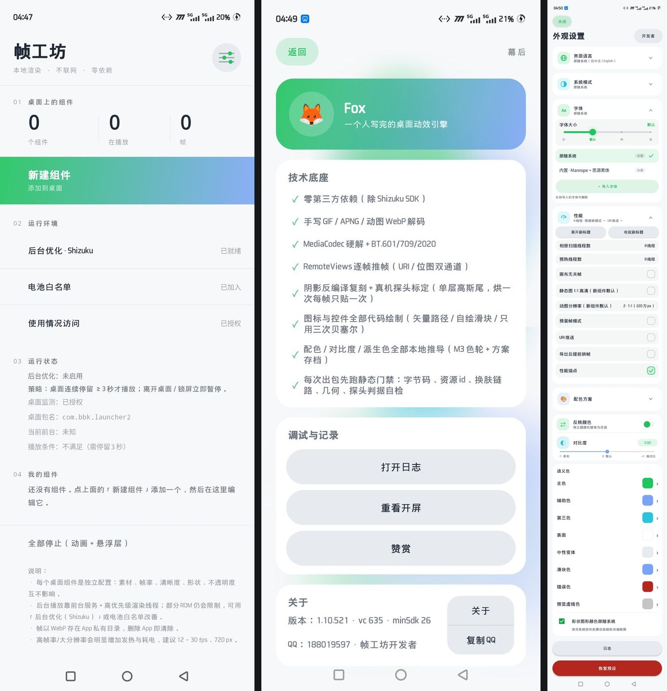
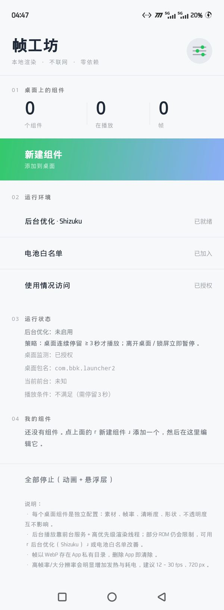
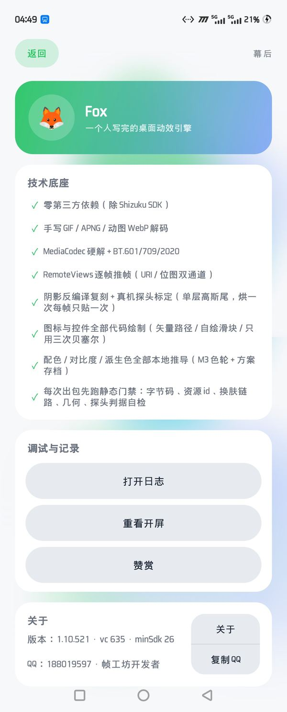
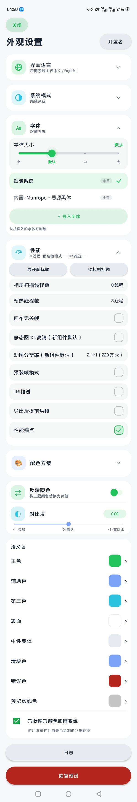
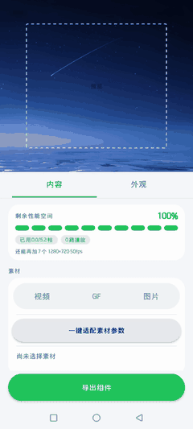
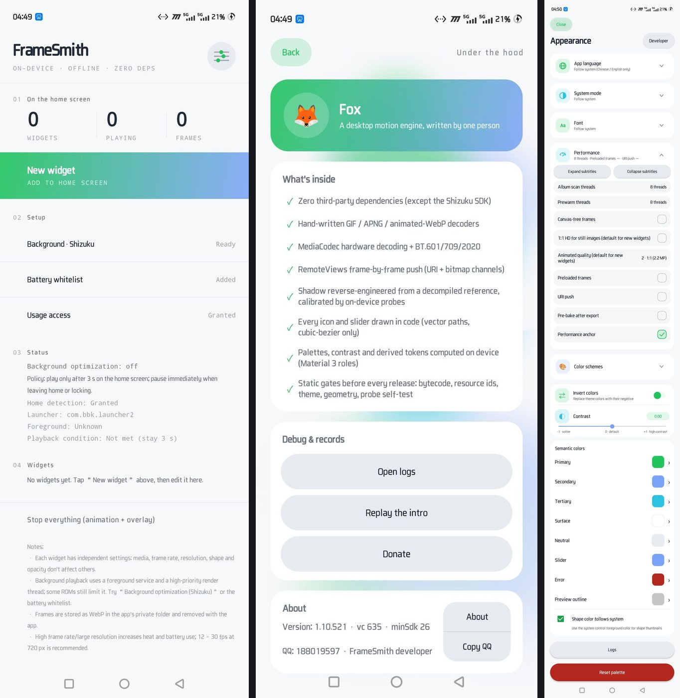
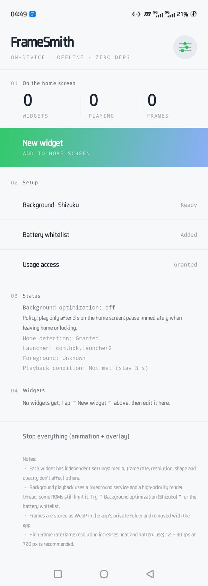
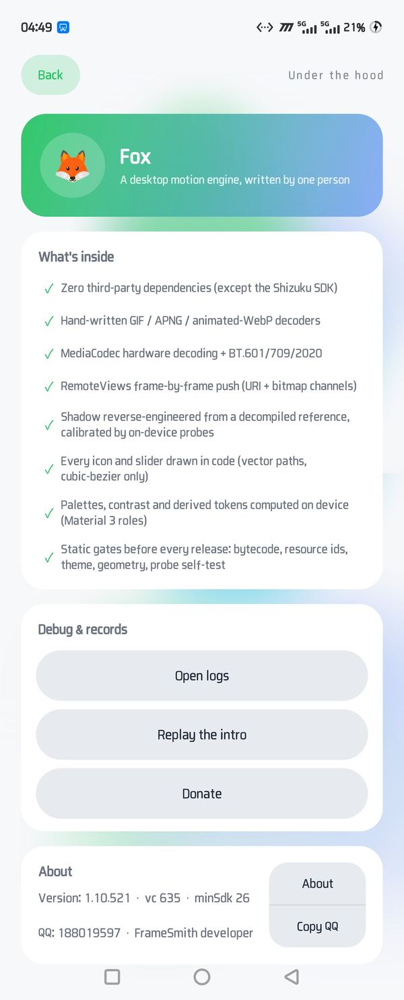
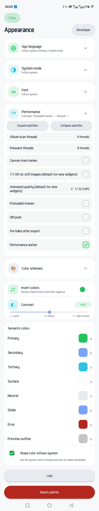
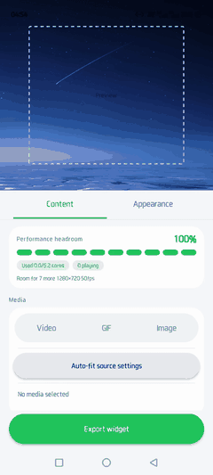

# 帧工坊 / FrameSmith

把视频、动图、图片做成安卓桌面的动态组件。每个组件独立配置素材、帧率、清晰度、蒙版形状、边框与阴影。

**[中文](#中文) ｜ [English](#english)**

---

## 中文

[界面](#界面) · [功能](#功能) · [下载](#下载) · [安装](#安装) · [权限](#权限) · [已知限制](#已知限制) · [技术要点](#技术要点) · [构建](#构建) · [仓库结构](#仓库结构) · [反馈](#反馈) · [赞赏](#赞赏) · [许可证](#许可证)

### 界面

**三个页面（左起：主页、开发者页、外观设置）**



<details>
<summary>逐张查看</summary>







</details>

**录屏：选素材 → 调参数 → 导出到桌面**



### 功能

- **素材**：MP4、GIF、APNG、动图 WebP 与静态图；导入后立刻看到首帧。视频硬件解码，按 BT.601 / 709 / 2020 转换色彩。
- **每个组件独立配置**：帧率 1–50 fps、清晰度 120–2560 px（8 px 一档）、压缩质量 50–100、不透明度、缩放、内容与蒙版旋转、偏移、阴影曲线、边框。
- **35 种蒙版形状**：方形、圆角、超椭圆、圆形、胶囊、菱形、三角、六边形、八边形、星形、心形、水滴、盾形、云、闪电、齿轮、太极等，可展开查看全部。
- **7 种布局**：原始比例、填充、16:9、4:3、1:1、9:16、21:9。
- **三档出图**：标准约 22 万像素，走位图通道；高清长边 1440、约 130 万像素；1:1 按卡片真实像素，上限 220 万像素，桌面不再放大。
- **拖动即适配**：在桌面改组件尺寸后，按新格子重新出图，不裁画面。
- **播放时机**：桌面停留满 3 秒才开始播放；离开桌面或锁屏立即停止。
- **外观与语言**：深浅色可跟随系统或手动切换，配色方案、对比度、反转、字体可调；界面语言可跟随系统，也可固定为中文或 English。
- **自查**：日志只保留最近 30 分钟（含崩溃记录），可导出 TXT 或长图；「关于」页显示版本、签名证书与更新检查；主界面可一键停止全部播放。

### 下载

| 版本 | 体积 | SHA-256 |
|---|---|---|
| v1.10.521 | 6,836,005 bytes（约 6.5 MiB） | `1fcb8dd707b2552c750b038fff4b67cf08db64b1c81ba7f4b5f304b36435804d` |

- 直接下载：<https://github.com/dlph-Ex/animwidget/releases/download/v1.10.521/AnimWidget-v1.10.521.apk>
- 全部版本：<https://github.com/dlph-Ex/animwidget/releases>

系统要求：Android 8.0 及以上（API 26），targetSdk 35。

校验下载：`sha256sum AnimWidget-v1.10.521.apk`，结果应与上表一致。

发行证书 SHA-256：安装后在应用内「关于 → 签名证书」即可核对。

`5E:9B:78:5C:93:2E:49:AD:62:1E:BE:FB:31:FB:14:66:59:2F:A9:62:88:29:55:A6:9C:EB:89:5D:04:EE:F4:D3`

### 安装

1. 下载 `AnimWidget-v1.10.521.apk`。
2. 允许浏览器或文件管理器「安装未知来源应用」。
3. **vivo / iQOO**：会提示「未备案」，点「授权本次安装」；若被「纯净模式」拦截，到 `设置 → 安全 → 纯净模式` 关闭后再装。
4. 安装后打开应用，点「＋ 新建组件」按提示添加到桌面。

升级直接覆盖安装即可，组件配置与素材都保存在应用私有目录里。

### 权限

| 权限 | 用途 | 可拒绝 |
|---|---|---|
| `FOREGROUND_SERVICE`<br>`FOREGROUND_SERVICE_SPECIAL_USE` | 播放期间的前台服务，逐帧投递 | 否 |
| `POST_NOTIFICATIONS` | 播放状态通知 | 是 |
| `SYSTEM_ALERT_WINDOW` | 仅「显示并调整位置」用的悬浮层 | 是 |
| `PACKAGE_USAGE_STATS` | 判断桌面是否在前台，切走就停播 | 是 |
| `READ_MEDIA_IMAGES`（Android 13+）<br>`READ_EXTERNAL_STORAGE`（仅 API ≤ 32） | 选择与预览素材 | 是 |
| `INTERNET` | 只在「关于」页点版本行时，向 GitHub Releases API 请求一次 | 普通权限 |
| Shizuku（`moe.shizuku.manager.permission.API_V23`） | 仅「后台优化」在本地执行 shell 命令；不装 Shizuku 就完全用不到 | 是 |

无统计 SDK、无广告、不上传任何数据。帧以 WebP 存放在应用私有目录，卸载应用即全部清除。除「关于」页那一次更新检测外，应用不发起任何网络请求。

### 已知限制

- **动态壁纸**：组件编辑页顶部的壁纸底图只能取到静态图；屏上是动态壁纸时，它与屏幕上的画面不是同一张。
- **桌面不报尺寸**：启动器不报 `OPTION_APPWIDGET_SIZES` 时，按估算值出图。
- **帧率上限**：逐帧推帧要经过启动器渲染，多个高帧率组件同时播放时，实际帧率可能低于设定值。
- **后台限制**：部分 ROM 会限制后台服务，可用「后台优化（Shizuku）」或电池白名单改善。
- **素材上限**：视频最长 40 秒（超出截取前 40 秒）；动图不截时长，但单组件最多 2400 帧，长动图会按 2400 帧反算帧率（帧率随之降低）。
- **重签会被限制**：发行包会校验自身签名，用别的证书重签后，推帧与导出会停止。

### 技术要点

- 手写 GIF / APNG / 动图 WebP 解码，视频走 MediaCodec 硬解。
- RemoteViews 逐帧推帧，位图与文件（URI）双通道，按启动器支持情况选择。
- 阴影曲线来自反编译复刻加真机标定，单层高斯尾，烘一次、每帧只贴一次。
- 图标与控件全部代码绘制，配色由 M3 色轮在本地推导。
- dex 里只有应用代码、Kotlin 运行时与可选的 Shizuku 客户端（`kotlin/*`、`rikka/shizuku/*`），没有 UI 框架，也没有统计或广告 SDK。

### 构建

出包不使用 Gradle，一条脚本：

```bash
./scripts/build-apk-src.sh 635 1.10.521   # javac → aapt2 → d8 → 打包 → apksig（v2 签名）
```

产物：`dist/AnimWidget-v1.10.521.apk`。

- 需要 JDK 17、`aapt2` 与 Python 3。
- 工具链 jar（`android-all.jar`、`jdk-core-stubs.jar`、`r8.jar`、`apksig.jar`、`signapk-cli.jar`、`kotlin-stdlib.jar`、`annotations-13.0.jar`、`shizuku-all.jar`、`shizuku-aidl.jar`、`core-lambda-stubs.jar`）放在 `toolchain/`，不随仓库分发；可用 `TOOLCHAIN=/path` 指定。
- 签名钥匙放在 `build-manual/debug.keystore`（别名 `androiddebugkey`），不随仓库分发，自己生成即可；keystore 与密钥口令写在脚本 `SignApk sign` 那一行，换成自己的钥匙时同步改脚本。
- 加 `OBFUSCATE=1` 可改走 R8 混淆（只改名，不裁剪、不优化）。
- 根目录的 Gradle 文件只供 IDE 打开工程，出包不用它们。
- 内置双语字体不随仓库分发：`patch-v1.4.0/res/font/anim_dual*` 缺失时也能出包，界面回退系统字体；想还原原字形就把这三个文件放回 `res/font/`。
- 自己出的包签名与发行证书不同，不能覆盖安装官方包，需要先卸载（配置与素材会清空）。
- 自建包还会撞上签名自检：`Integrity` 只认发行证书，换钥匙即判为 `BAD_CERT`，推帧与导出会被停用。要让自建包正常工作，得把 `src-v2/io/github/animwidget/Integrity.java` 里的 `W` 常量换成你自己的证书 SHA-256（8 个 int）。

### 仓库结构

```
src-v2/         唯一源码树（Java，io.github.animwidget）
patch-v1.4.0/   资源与清单：res/、AndroidManifest.xml、stable-ids.txt
scripts/        出包脚本：build-apk-src.sh、pack_apk.py、sync-r.py、r8-rules.pro
app/            早期 Gradle 骨架，不参与出包
```

- 读代码从 `src-v2/` 开始；`patch-v1.4.0/` 的目录名是历史遗留，实际就是当前这一代的资源与清单，里面除 `res/`、`AndroidManifest.xml`、`stable-ids.txt` 之外的旧工具不参与出包。
- 静态门禁、自检脚本与过程记录只保留在维护者本地，不随仓库分发；仓库里只有 4 个脚本。

### 反馈

请到 [Issues](https://github.com/dlph-Ex/animwidget/issues) 提，附上：机型与系统版本、启动器名称、复现步骤，以及应用内「设置 → 日志 → 导出日志」生成的文件。

### 赞赏

完全自愿，不影响任何功能。Ko-fi：<https://ko-fi.com/frost_doplhin>。微信 / 支付宝：应用内「设置 → 开发者 → 赞赏」直接扫码。

### 许可证

MIT。Copyright (c) 2026 AnimWidget contributors。全文见 [LICENSE](LICENSE)。

---

## English

[Screenshots](#screenshots) · [Features](#features) · [Download](#download) · [Install](#install) · [Permissions](#permissions) · [Known limitations](#known-limitations) · [How it works](#how-it-works) · [Build](#build) · [Repository layout](#repository-layout) · [Feedback](#feedback) · [Sponsor](#sponsor) · [License](#license)

### Screenshots

**Three pages (left to right: Home, Developer page, Appearance)**



<details>
<summary>View one by one</summary>







</details>

**Recording: pick media → tune settings → export to the home screen**



### Features

- **Media**: MP4, GIF, APNG, animated WebP and still images; the first frame previews as soon as you import. Video is hardware-decoded with BT.601 / 709 / 2020 colour conversion.
- **Per-widget settings**: frame rate 1–50 fps, sharpness 120–2560 px (8 px steps), quality 50–100, opacity, scale, content and mask rotation, offset, shadow curve, border.
- **35 mask shapes**: rect, rounded, squircle, circle, capsule, diamond, triangle, hexagon, octagon, stars, heart, teardrop, shield, cloud, bolt, gear, yin-yang and more; expand the picker to see every shape.
- **7 layouts**: original ratio, fill, 16:9, 4:3, 1:1, 9:16, 21:9.
- **Three quality tiers**: standard ~220k px over the bitmap channel; HD (long edge 1440, ~1.3M px); 1:1 at real card pixels, capped at 2.2M px, no upscaling on the home screen.
- **Refit on resize**: resize the widget on the home screen and it re-renders for the new cell instead of cropping.
- **When it plays**: playback starts only after the home screen has stayed visible for three seconds, and stops as soon as you leave the home screen or lock the device.
- **Look and language**: light and dark themes (follow the system or force one), colour schemes, contrast, inversion and font settings; the UI language follows the system or is pinned to Chinese or English.
- **Diagnostics**: logs keep the last 30 minutes (crashes included) and export as TXT or long images; the About sheet shows the version, signing certificate and an update check; the main screen can stop all playback at once.

### Download

| Version | Size | SHA-256 |
|---|---|---|
| v1.10.521 | 6,836,005 bytes (~6.5 MiB) | `1fcb8dd707b2552c750b038fff4b67cf08db64b1c81ba7f4b5f304b36435804d` |

- Direct download: <https://github.com/dlph-Ex/animwidget/releases/download/v1.10.521/AnimWidget-v1.10.521.apk>
- All releases: <https://github.com/dlph-Ex/animwidget/releases>

Requirements: Android 8.0+ (API 26), targetSdk 35.

Verify: run `sha256sum AnimWidget-v1.10.521.apk` and compare it with the table above.

Release certificate SHA-256 — check it in the app under "About → Signing cert":

`5E:9B:78:5C:93:2E:49:AD:62:1E:BE:FB:31:FB:14:66:59:2F:A9:62:88:29:55:A6:9C:EB:89:5D:04:EE:F4:D3`

### Install

1. Download `AnimWidget-v1.10.521.apk`.
2. Allow your browser or file manager to install unknown apps.
3. **vivo / iQOO**: a missing-ICP-filing warning is expected — tap "Authorize this installation". If Pure Mode blocks it, turn Pure Mode off under `Settings → Security → Pure Mode`.
4. Open the app and tap "＋ New widget" to add it to the home screen.

Upgrades are plain installs over the old version; widget configs and media stay in the app's private storage.

### Permissions

| Permission | Why | Optional |
|---|---|---|
| `FOREGROUND_SERVICE`<br>`FOREGROUND_SERVICE_SPECIAL_USE` | foreground service that delivers frames while playing | No |
| `POST_NOTIFICATIONS` | playback status notification | Yes |
| `SYSTEM_ALERT_WINDOW` | overlay used only by "show and adjust position" | Yes |
| `PACKAGE_USAGE_STATS` | detect whether the launcher is in front, to pause when hidden | Yes |
| `READ_MEDIA_IMAGES` (Android 13+)<br>`READ_EXTERNAL_STORAGE` (API 32 and below only) | pick and preview media | Yes |
| `INTERNET` | one GitHub Releases API request, only when the version row in About is tapped | normal permission |
| Shizuku (`moe.shizuku.manager.permission.API_V23`) | shell commands run locally by "background optimization"; unused unless Shizuku is installed | Yes |

No analytics SDK, no ads, nothing uploaded. Frames live as WebP in the app's private storage and are erased when you uninstall. Apart from that single update check, the app makes no network requests.

### Known limitations

- **Live wallpapers**: the wallpaper strip at the top of the editor can only use a static image; with a live wallpaper it is not the same picture as the one on screen.
- **Launchers without size reports**: when a launcher does not report `OPTION_APPWIDGET_SIZES`, the render uses an estimate.
- **Frame-rate ceiling**: frames are pushed through the launcher's rendering, so several high-frame-rate widgets together can end up below the configured rate.
- **Background limits**: some ROMs throttle background services; "background optimization (Shizuku)" or the battery whitelist helps.
- **Media limits**: video may last 40 seconds (the first 40 s are used); animations are not truncated, but a widget is capped at 2400 frames, and long animations have their frame rate recalculated from that 2400-frame budget.
- **Re-signed builds are limited**: the release build verifies its own signature; a build re-signed with another certificate stops pushing frames and exporting.

### How it works

- GIF, APNG and animated WebP decoders are written from scratch; video goes through MediaCodec.
- Frames are pushed through RemoteViews on two channels, bitmaps and files (URIs), picked according to what the launcher supports.
- The shadow curve is a decompiled reimplementation calibrated on real devices: one Gaussian tail, baked once and pasted per frame.
- Icons and controls are drawn entirely in code; colours are derived locally from an M3 colour wheel.
- The dex holds only the app, the Kotlin runtime and the optional Shizuku client (`kotlin/*`, `rikka/shizuku/*`) — no UI framework, no analytics or ad SDK.

### Build

The build does not use Gradle — it is one script:

```bash
./scripts/build-apk-src.sh 635 1.10.521   # javac → aapt2 → d8 → pack → apksig (v2 signature)
```

Output: `dist/AnimWidget-v1.10.521.apk`.

- Needs JDK 17, `aapt2` and Python 3.
- Toolchain jars (`android-all.jar`, `jdk-core-stubs.jar`, `r8.jar`, `apksig.jar`, `signapk-cli.jar`, `kotlin-stdlib.jar`, `annotations-13.0.jar`, `shizuku-all.jar`, `shizuku-aidl.jar`, `core-lambda-stubs.jar`) live in `toolchain/` and are not shipped; override with `TOOLCHAIN=/path`.
- The signing key belongs in `build-manual/debug.keystore` (alias `androiddebugkey`); it is not shipped — generate your own. The keystore and key passwords are the arguments on the `SignApk sign` line in the build script; edit that line if you bring your own key.
- Prefix with `OBFUSCATE=1` to build through R8 (renaming only, no shrinking or optimising).
- The Gradle files at the root only serve IDE import; the build does not use them.
- The built-in bilingual font is not shipped: without `patch-v1.4.0/res/font/anim_dual*` the build still works and the UI falls back to the system font; drop those three files back into `res/font/` to get the original glyphs.
- A self-built APK carries a different signature, so it cannot install over the official one — uninstall first, which clears configs and media.
- A self-built APK also trips the integrity check: only the release certificate is accepted, and a `BAD_CERT` build stops pushing frames and exporting. To make a self-built APK fully work, replace the `W` constant in `src-v2/io/github/animwidget/Integrity.java` with your own certificate's SHA-256 (eight ints).

### Repository layout

```
src-v2/         the only source tree (Java, io.github.animwidget)
patch-v1.4.0/   resources and manifest: res/, AndroidManifest.xml, stable-ids.txt
scripts/        build scripts: build-apk-src.sh, pack_apk.py, sync-r.py, r8-rules.pro
app/            legacy Gradle skeleton, not used by the build
```

- Start reading in `src-v2/`. The `patch-v1.4.0/` name is historical — it is today's resources and manifest, and the older tooling inside it is unused.
- Static gates, self-tests and working notes stay with the maintainer; the repository carries only four scripts.

### Feedback

Open an [issue](https://github.com/dlph-Ex/animwidget/issues) with your device model, OS version, launcher name, reproduction steps and the log exported from `Settings → Logs → Export log`.

### Sponsor

Entirely optional. Ko-fi: <https://ko-fi.com/frost_doplhin>. WeChat / Alipay: scan inside the app under `Settings → Developer → Donate`.

### License

MIT. Copyright (c) 2026 AnimWidget contributors. Full text in [LICENSE](LICENSE).
